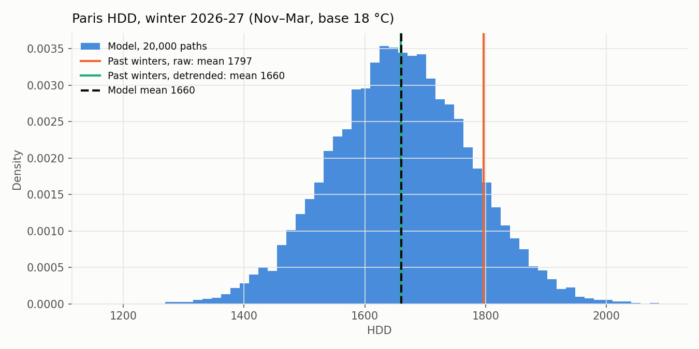
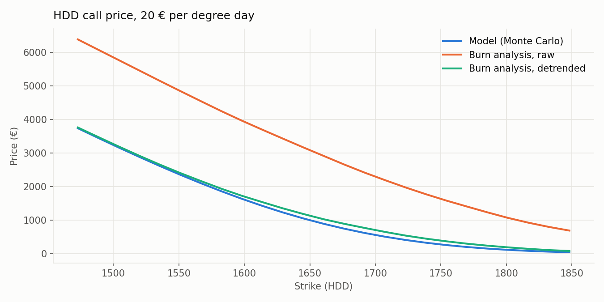
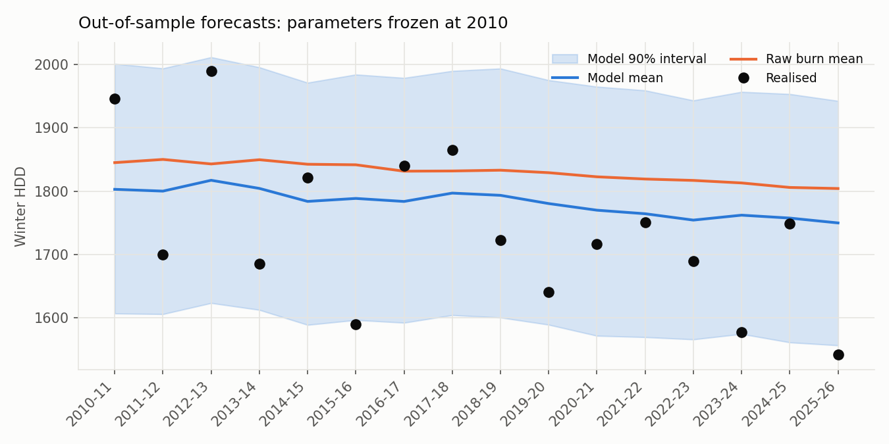
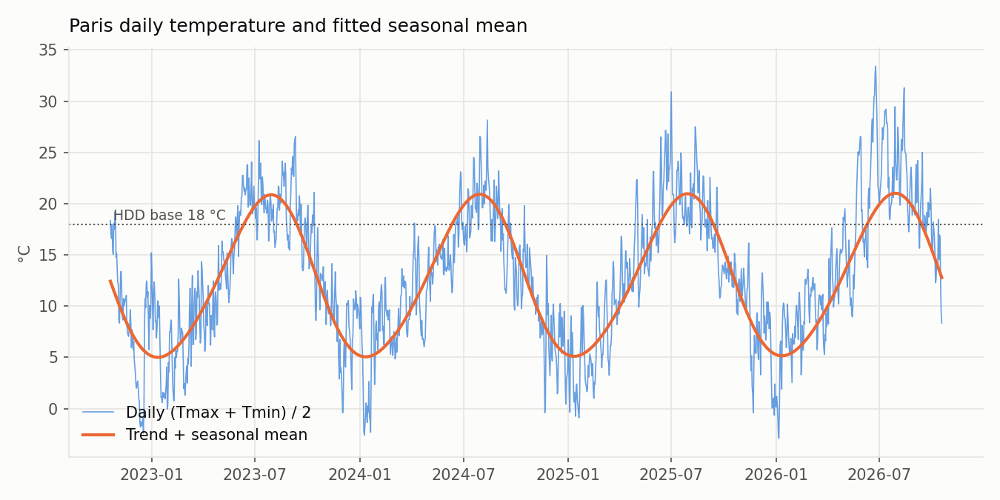
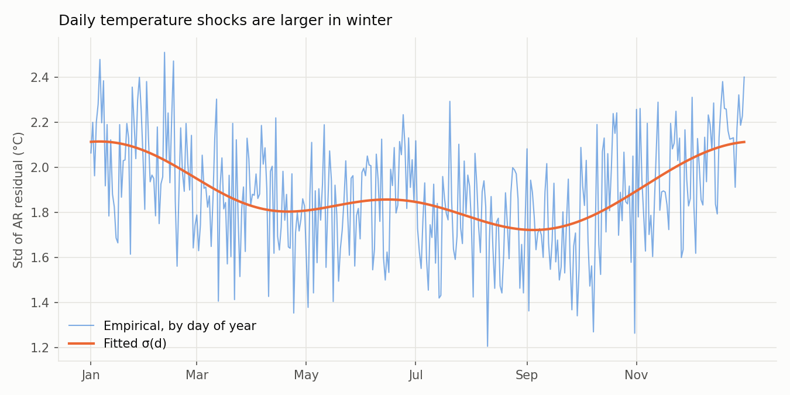
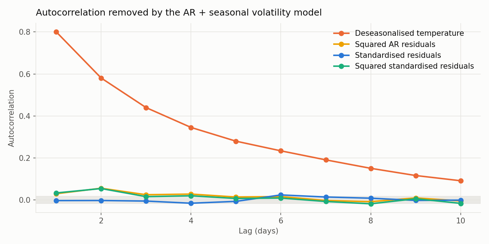

# Paris winter HDD options — temperature model, pricing and backtest

How much should an energy supplier pay to be protected against a cold winter in Paris?
This project prices **heating degree day (HDD) options** on Paris temperature, from 35 years of daily data:
a temperature model with trend, seasonality and seasonal volatility, Monte Carlo pricing, a comparison with
the market's *burn analysis*, and an out-of-sample backtest.

<!-- RESULTS:START -->
## Results (data 1991-01-01 to 2026-10-19, 13,067 days)



| Model | Value |
|---|---|
| Warming trend | +0.50 °C per decade |
| AR order (BIC) | 3 |
| Daily shock volatility, winter / summer | 2.11 / 1.82 °C |
| Lag-1 autocorrelation, before / after AR filter | 0.801 / -0.003 |
| Standardised shocks: skew / excess kurtosis | 0.122 / 0.166 |

**Winter 2026-27**: expected HDD **1660**, 90% range [1473, 1848].
Call, strike 1660, 20 € per HDD:

| Method | Price |
|---|---|
| **Model (Monte Carlo)** | **902 €** (± 18) |
| Model with market price of risk λ = 0.05 | 1,776 € |
| Burn analysis, raw | 2,928 € |
| Burn analysis, detrended | 1,037 € |



**Backtest** (16 winters, parameters frozen at 2010-10-31): realised HDD inside the model's
90% interval in 88% of winters, mean PIT 0.39 (0.5 if unbiased).
Forecast RMSE: model 120 HDD, raw burn 149, detrended burn 122.



<details><summary>Model diagnostics</summary>




</details>
<!-- RESULTS:END -->

## Contract

HDD = Σ max(18 °C − T, 0) over the winter (November 1 – March 31), with T = (Tmax + Tmin) / 2,
the market convention. A call pays **20 € per HDD** above the strike: it pays when the winter is cold,
which is when a supplier's gas and power demand jumps.

## Model

    T(t)   = a + b·t + Σ_k [c_k cos(2πk d/365) + s_k sin(2πk d/365)] + X(t)
    X(t)   = φ_1 X(t−1) + … + φ_p X(t−p) + σ(d) ε(t)
    σ²(d)  = Fourier series in the day of year d

- **Trend b**: the warming of the climate, the first-order effect on HDD prices
- **AR(p)**, order chosen by BIC: day-to-day persistence of temperature anomalies (cold spells last)
- **Seasonal volatility σ(d)**: temperature shocks are larger in winter than in summer
- Discrete-time version of the CAR models of Benth & Šaltytė-Benth, which extend the
  Ornstein–Uhlenbeck model of Alaton, Djehiche & Stillberger (the AR(1) case)

Each step is checked on the residuals: autocorrelation before and after the AR filter, autocorrelation
of squared residuals after scaling by σ(d), skewness and kurtosis of the standardised shocks.

## Pricing

- **Monte Carlo**: 20,000 winters simulated from the latest observed temperatures. Actuarial price
  (physical measure, discounted at 3%), plus an illustrative market price of risk λ, since the weather
  market is incomplete and there is no replicating portfolio
- **Burn analysis**: replay past winters, raw and detrended to today's climate. With a warming trend,
  raw burn replays colder winters and overprices HDD calls

## Backtest

Parameters frozen on data before November 2010; each later winter is forecast from the temperatures
observed up to October 31. Checked: coverage of the 90% interval, PIT values, and forecast error of the
model against raw and detrended burn.

## Validation (`pytest`)

On synthetic data generated with known parameters: parameter recovery (seasonal mean, AR coefficients,
variance), white-noise standardised residuals, call–put parity, cap on the payout, and calibrated forecasts
(PIT) under the true model.

## Limitations

- **Trend extrapolation is the main model risk**: a linear trend fitted on 20–35 years is uncertain, and
  the backtest shows directly what a misestimated trend does to forecasts
- Gaussian shocks: real cold spells are often sharper than warm spells (skewness)
- ERA5 reanalysis grid point, not the official station used in contracts (e.g. Paris-Orly)
- One city: no basis risk between the contract station and the client's own demand

## Run it

```bash
pip install -r requirements.txt
python run.py              # downloads Paris temperatures once (Open-Meteo), writes figures/ and results.json
python run.py --synthetic  # offline, on synthetic data
python -m pytest -q
```

Or open `notebooks/paris_hdd_options.ipynb` in Google Colab, which walks through each step.

Data: [Open-Meteo historical weather API](https://open-meteo.com/en/docs/historical-weather-api) (ERA5 reanalysis, Copernicus / ECMWF).

## Structure

```
src/data.py       download from Open-Meteo, cleaning, synthetic data
src/model.py      trend + seasonal mean, AR(p) by BIC, seasonal volatility, simulation, diagnostics
src/pricing.py    HDD index, contracts, Monte Carlo price, burn analysis, out-of-sample backtest
run.py            full pipeline: figures and results.json
notebooks/        step-by-step notebook (Colab-ready)
tests/            validation on synthetic data
```

## References

- P. Alaton, B. Djehiche, D. Stillberger (2002). *On modelling and pricing weather derivatives.* Applied Mathematical Finance.
- F. E. Benth, J. Šaltytė-Benth (2007). *The volatility of temperature and pricing of weather derivatives.* Quantitative Finance.
- S. Jewson, A. Brix (2005). *Weather Derivative Valuation.* Cambridge University Press.
